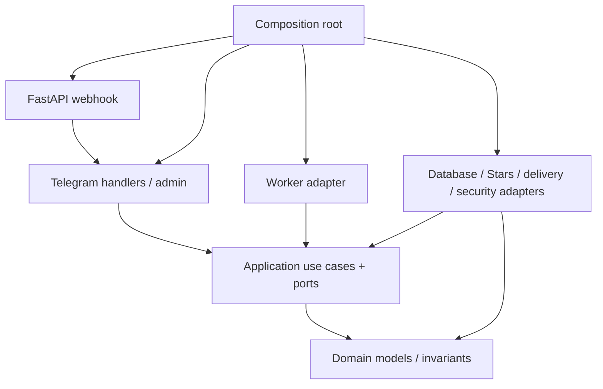

# Kiến trúc TeleBotShop

## Trạng thái và lựa chọn

Payment V2 theo [ADR-0006](adr/0006-payment-v2-wallet.md): Bank/USDT là top-up rails;
Wallet Credit là order payment chính trong sandbox. Stars PAUSED/BLOCKED, giữ module cũ.
`WalletCheckoutService` ghi debit/order/payment/allocation/work trong cùng UoW, không gọi
OrderService→PaymentService hay tạo receipt XTR. T09/T10 worker, mã hóa/manual/resend dùng chung.
`payments` là union có shape constraints riêng Stars/CRD, mỗi order có immutable method.
Các guards Stars gốc giữ nguyên function text; triggers có WHEN Stars, còn wallet có guards
deferred riêng để kiểm tra exact debit và compensating refund. Chi tiết schema/locks/rollback
ở [spec](plans/shop/payment-v2.md) và [DATABASE](DATABASE.md#payment-v2).

T15 `CouponService` quản lý immutable coupon rules bằng existing Wallet PRICE permission;
preview không giữ lượt. `WalletCheckoutService` revalidate quote dưới buyer→product→coupon
row locks rồi ghi redemption/base-discount-net snapshot cùng debit/PAID/work/audit trong
một UoW. SQL deferred guard giữ exact net payment binding; refund không hoàn usage. Module
`domain/models/coupons.py` không phụ thuộc SDK/ORM. Composition root tái sử dụng actor-bound
NavigationStore cho admin qua hai callbacks remember/resolve, giữ admin không import bot.

`application/services/{wallet,wallet_checkout,topups,topup_review,wallet_refunds,payment_reconciliation}.py`
sở hữu transaction/quyết định; SQL repos thực hiện query và không commit.
`infrastructure/payments/` chứa SePay HMAC/QR/read API và Binance read-only/simulated adapter;
`api/bank_webhook.py` chỉ xử lý transport. `admin/payment_operator.py` có authentication local
độc lập Telegram, vẫn gọi use cases/current grants. Chỉ `bootstrap.py` wire concrete services.

Đây là baseline thiết kế được SE/SA chọn theo ủy quyền của Owner. T01–T13 đã triển khai toolchain/runtime, HTTP health, PostgreSQL/UoW/migrations, identity/permission/audit, catalog/admin/inventory, orders/payment/refund, typed worker/manual, history/resend và encrypted tickets. T14 nối public Buy/terms/invoice, customer lookup, explicit test transport, authenticated bounded webhook và durable operational notifications; Telegram test E và production deployment chưa được nghiệm thu. Yêu cầu gốc ở [`task.md`](../task.md); lý do chọn kiến trúc ở [ADR-0001](adr/0001-modular-monolith.md). Chỉ dựng package/file khi một slice cần dùng, không tạo toàn bộ cây trống.

Chọn **modular monolith**, một codebase/image, PostgreSQL là nguồn dữ liệu bền vững. Production dự kiến có hai process từ cùng image: HTTP ingress và fulfillment worker. Local polling chỉ là adapter development thay thế webhook, không chạy cùng webhook cho cùng bot.



Mũi tên biểu diễn phụ thuộc code. Application gọi external effects qua port được inject; implementation của port thuộc infrastructure. Không có service locator, mediator/event bus, generic repository, base-service hierarchy hay DI framework.

## Cấu trúc đích

```text
src/telebotshop/
  __main__.py                 # entrypoint chọn ingress / worker / dev polling
  bootstrap.py                # composition root; tạo và đóng resources
  domain/
    models/                   # identity, catalog, inventory, orders, fulfillment
    errors.py                 # business errors thuần Python
  application/
    services/                 # use cases theo nghiệp vụ, không chứa Telegram handlers
    ports/                    # Protocol tối thiểu cho persistence và external effects
  bot/
    routers/                  # start, catalog, checkout, orders, support
    keyboards/                # callback/keyboard builders; không truy cập DB
    texts/                    # nội dung tiếng Việt, tổ chức để thêm locale sau
  admin/                      # Telegram admin routers/keyboards; không phải business layer
  api/                        # FastAPI factory, webhook, liveness/readiness
  workers/                    # vòng chạy/claim jobs; gọi use cases
  infrastructure/
    config.py                 # Pydantic Settings; load ở bootstrap, không import-time I/O
    database/
      models/                 # SQLAlchemy models; tách khỏi domain
      repositories/           # SQL/query implementations
      uow.py                  # AsyncSession/transaction implementation
    telegram/                 # ingress guard/logging và Stars invoice adapter
    delivery/                 # send message/document adapters
    crypto.py                 # AES-GCM/HMAC adapter; settings ở config.py
migrations/                   # Alembic; thêm dần cùng slice cần schema
tests/
  unit/
  integration/                # PostgreSQL thực, kể cả race/migration cases
  contract/                   # Telegram/webhook boundary, external API mocked
  architecture/               # kiểm tra import direction bằng AST
```

Hàm/DTO đặt cạnh use case sở hữu; chỉ tách module chung khi có nhu cầu thật. Không tạo sẵn file cho mọi item trong cây. Mapping capability → trách nhiệm nằm trong [spec index](plans/shop/README.md), không sinh microservice cho từng capability.

HTTP entrypoint `python -m telebotshop`/`telebotshop` (hoặc `telebotshop http`) giữ độc lập.
T03 thêm `telebotshop polling` cho development/test: `bootstrap.py` wire IdentityService,
AccessService, per-call UoW factory, customer/admin routers, ingress guard và Bot client.
Polling kiểm tra schema/Owner rồi từ chối existing webhook, không delete/drop updates.
T07 dùng native concurrent updates cap 32 để pre-checkout không chờ download; UoW/session
vẫn riêng từng task. Shutdown drain/cancel trong 10s trước đóng Bot/engine, kể cả lỗi/cancel;
SDK 3.31.0 chưa có public drain, dùng pending-task set private với regression tests. T09 có worker riêng.
HTTP factory vẫn nhận readiness callable/lifespan, không import concrete DB adapter.
Schema/transaction contract ở [DATABASE](DATABASE.md), controls/limits ở [SECURITY](SECURITY.md).

T06 thêm OrderService/InvoiceService, orders/invoices ports và SQL order/item/invoice tables.
Create khóa buyer (NO KEY UPDATE) → product → AVAILABLE unit; cancel/expiry/invoice khóa
order trước invoice/unit. Một UoW ghi snapshot + reservation + intent + audit. InvoiceService
commit claim trước gọi sender, đóng UoW rồi mới network, sau đó persist typed outcome trong
UoW khác. Không có DB session sống qua API call. `StarsInvoiceSender` nằm cạnh Telegram
adapters hiện có; chỉ composition root/tests được wire concrete implementations.
`expire-orders` là entrypoint một batch DB-only, chưa có process scheduler. Public polling
được nối Buy/invoice qua CheckoutService ở T14 sau khi intake tài chính đã an toàn.

T07 thêm PreCheckoutService và callable port (`PreCheckout` → bool), nối qua orders port
hiện có; không tạo repository riêng cho một approval row. `infrastructure/telegram/pre_checkout.py`
chứa SDK parsing/answer và SQLAlchemy/SDK error mapping; chỉ import application port/domain.
Service khóa order→product→unit, ghi approval/TTL/audit trong UoW; adapter đóng UoW trước
AnswerPreCheckoutQuery. T08 wire checker thật cùng receipt intake; tests dùng PostgreSQL
và Telegram mock. Approval không tạo payment/fulfillment.

T08 PaymentService dùng payments port + UoW hiện có; lock charge → order → exact reserved
unit. Receipt/PAID/allocation/READY intent/redacted audit commit cùng nhau. Late receipt khi
reservation đã mất tạo PAID + attention, không gọi worker hoặc decrypt. Domain CommittedWork
là contract finite dùng chung; repo trả DTO, không trả SQL rows/session.
`infrastructure/telegram/payments.py` giữ một parser/router và PaymentsDispatcher mỏng: native
aiogram 3.31.0 set offset sau yield, nên wrapper persist successful_payment trước yield.
Handler lặp lại chỉ dedup. Financial message bypass ordinary private/rate/error guard để
không mất receipt; DB failure propagate tới caller. Đây là private SDK hook có regression
tests; phải kiểm tra lại khi nâng pin. Production webhook/auth/body cap còn pending, ASGI
ack harness không phải ingress production hoặc live validation.

T09 FulfillmentService dùng cùng CommittedWork, fulfillment port/repo + InventoryCipher.open
sau entitlement checks. Claim transaction chỉ khóa work; commit trước prepare order→work.
Attempt UUID là fencing token, lease nằm trên attempt, work giữ active attempt/due/send count/
hold/attention. Prepare commit SENDING rồi sender mới gọi Telegram ngoài UoW; complete/recover
khóa order→work và giữ late result observations. FAILED vẫn giữ payment/allocation.
`workers/fulfillment.py` chỉ loop/recover/idle wait qua service, không SDK/SQL/crypto; bootstrap
wire WorkerSettings/policy/cipher/repo/sender, đóng Bot/engine khi exit. `infrastructure/delivery/finite.py`
gửi typed payload qua port, mapping known rejection khác uncertain; T10 mở rộng dispatch
file/reusable/manual. Current hold là FD-06 pre-send boundary, refund
operations ở T13; public Buy/core navigation ở T14, không suy whole-shop success từ worker.

Domain identity/access/admin DTO là dataclass/enum thuần Python; application services sở
hữu validation, permission và transaction. Repositories dùng SQLAlchemy Core metadata,
chỉ trả DTO. Owner/grants/settings/audit/confirmations là schema T03, không tạo commerce
tables trước T04. Authorization lock giữ tới hết protected transaction; read/menu permission
check không thay thế quyền hiện tại của mutation.

T04 thêm CatalogService và catalog port/repository/Core tables; category/product/price/sale/
photo mutations dùng catalog-owned durable confirmation cùng audit table hiện có. Product
row lock + version CAS bảo vệ edits; cả handler và use case kiểm tra current `catalog.manage`.
Customer/admin catalog routers chỉ gọi services. Customer navigation store giữ bounded
actor-bound browse parameters trong instance router, không giữ products/roles/price/stock;
restart/expiry mở lại `/shop`. Public models chỉ có typed public metadata/photo, không có
inventory hoặc delivery payload. Orders/fulfillment tables chỉ thêm khi tới task sở hữu.

T05 thêm InventoryService, application parser/ports và typed key/license DTOs. Crypto adapter
ở infrastructure dùng cryptography; domain/application không import crypto library/config.
Pending import lưu sealed units, confirm import/retire + audit atomic qua cùng UoW. Crypto
key registration guard và PostgreSQL constraints giữ identity/dedup; không expose decrypt
use case trước entitlement. Admin router chỉ validate transport/render, download bounded
memory qua Telegram SDK ngoài transaction rồi gọi use case kiểm tra lại quyền. Bootstrap
wire InventorySettings/cipher/service/router; stock DTOs chỉ có IDs/status/counts.

T10 ResourceService có port/repository riêng cho encrypted immutable resource versions,
confirmed publication và order-resource bindings. Checkout khóa product để chốt source;
PreCheckoutService/PaymentService kiểm tra binding cho nonfinite, giữ finite reservation/
allocation path. CommittedWork mở explicit resource ID; DB XOR/FKs tách unit với reusable
source. Cùng InventoryCipher adapter phục vụ `inventory:v1`, `resource:v1` và
`manual-evidence:v1` contexts; domain/application không kéo thư viện mã hóa vào.

FulfillmentService kiểm tra source type/metadata sau authorized open; sender nhận typed
file/text/document hoặc ManualNotice, không nhận staff instructions. Manual notice SENT
đưa work AWAITING_MANUAL, order còn FULFILLING. ManualFulfillmentService sở hữu protected
queue/detail/confirmation/completion với `fulfillment.manage`, evidence AAD riêng và audit
digest. Staff completion khóa access→order→work→action, atomic cùng order DELIVERED;
hold thắng trước completion chặn decrypt/complete, không tự retry uncertain notice.
Admin resource/manual routers chỉ parse/render và gọi use cases; bootstrap wire mọi
concrete service/cipher/repo/router, network nằm ngoài UoW.

T11 HistoryService đọc projection không secrets qua history port/repository; customer scope
gắn buyer, staff cần current orders.read. Staff dashboard/list có 30-day bound, customer
pagination 5 items. ResendService sở hữu confirmation và ba bước begin/send/complete,
reuse reader `application/services/entitlements.py` cùng FulfillmentService. Reader kiểm tra
paid binding trước ciphertext/decrypt; transport chỉ nhận typed request tới buyer gốc.
Resend actions/observations không sửa primary work, allocation hoặc source snapshot.
Staff resend cần thêm fulfillment.manage; access→order→work→action locks giữ current grant,
hold và confirmation. PostgreSQL guard serialize resend begin với hold; in-flight/uncertain
chặn hold mới. Quá send deadline không auto-retry, late result không xóa uncertainty.
Router orders phục vụ customer/staff commands và callbacks; bootstrap wire service/sender.

T12 SupportService sở hữu ticket/customer/order scope, current tickets.manage, persisted
SUPPORT assignment, immutable encrypted messages và confirmed assignment/closure. Port/repo
trả DTO; public queue không select ciphertext. Shared access lock trước ticket row lock giữ
quyền tới commit; decrypt chỉ sau scope check, read/mutation audit atomic. Thread 1 tin/trang,
queue 5/trang. Support order projection không mở general history hoặc entitlement reader.
Keyring chung thêm `support-message:v1` AAD gắn ticket/customer/message/author/staff/version.
Không có Telegram call trong UoW hoặc thay đổi payment/work/allocation từ ticket operations.

Bootstrap load optional public terms file một lần trước Bot/DB, inject PublicTerms snapshot
vào SupportService; thiếu cấu hình trả chưa sẵn sàng, file lỗi/placeholder fail startup an toàn.
Router support chỉ validate/render private commands/callbacks; phản hồi lưu inbox, không
push notification trong T12; T14 thêm metadata-only reply notification. Refund/reconciliation
T13 là use case riêng; ticket operations không tự sửa payment.

T13 RefundService sở hữu current payments.refund, verified charge, encrypted decision và
actor/payment/state-snapshot/expiry-bound intent. Access→charge→order→work→resend→intent
locks serialize với financial intake/worker/resend/manual; begin commit owned hold + SENDING
trước RefundGateway.refund, completion/audit dùng UoW khác. No automatic network retry.
Primary success mới đổi REFUNDED; extra charge không đổi entitlement hợp lệ bằng charge khác.

RefundGateway adapter chỉ map validated bounded Bot API result/transaction evidence; admin
router parse/render, không quyết định tiền/quyền. `refund_receipts.apply_received_refund`
được PaymentService và RefundService dùng trong UoW để xử lý event tới trước/sau payment.
System receipt ledger giữ provenance; privileged verify/reconcile audit dùng actual actor.
Cipher thêm refund-evidence:v1 gắn payment/action/key version; previous contexts giữ nguyên.
Fulfillment query chỉ đọc DTO fields, không expose owned refund pointer ra domain delivery.

SENDING/UNCERTAIN không tự mở lại. Positive refund evidence đóng ledger thành SUCCEEDED;
explicit uncertainty decision chỉ cho phép refund sau hết delivery/resend lease, giữ nguyên
attempts/observations và uncertainty, không tuyên bố thu hồi tài nguyên. Authenticated refund
event có thể đến khi delivery đang gửi: giữ hold/order REFUNDED và chỉ lưu late observation.
Không suy external acceptance từ local tests; Telegram test gate E vẫn pending.

T14 CheckoutService gọi OrderService/InvoiceService hiện có, giữ source/price/owner checks
ở application. Buy nonce chỉ là idempotency key; không nhận giá/buyer từ callback. Full
terms SHA-256 lưu audit idempotent trước invoice claim; callback mang digest prefix 96 bit
để từ chối consent cũ, không phải chữ ký hoặc authorization. Public terms snapshot load lúc
startup dùng chung support/checkout. Catalog availability chỉ đọc counts/metadata, không decrypt.
HistoryService reuse buyer UUID filter với current orders.read cho bounded customer lookup.

Composition root create_bot chọn fixed SDK PRODUCTION/TEST endpoint từ cấu hình riêng,
không infer từ APP_ENV hoặc nhận arbitrary host. Polling và webhook dùng chung runtime_dispatcher.
HTTP webhook adapter auth/stream cap/timeout/concurrency trước SDK parsing; infrastructure
validate Update rồi gọi dispatcher. Financial handlers awaited commit trước HTTP 200; lỗi
trả 503. Health-only app vẫn không cần Bot/keys. Không automatic set/delete webhook.

NotificationService dùng durable notifications repository/outbox trong PostgreSQL, reuse
worker lifecycle. Discovery bounded, current Owner/customer và source recheck trước SENDING
commit; NotificationSender gọi Telegram ngoài UoW, completion/late observation dùng UoW khác.
Metadata-only envelope, no payload/decrypt. Unique kind/target/recipient/revision + SKIP LOCKED
chặn duplicate discovery/two workers; uncertainty terminal, không automatic resend. Operational
alerts gửi persisted Owner, support latest reply gửi đúng customer; staff theo dõi assigned inbox.

## Ma trận import bắt buộc

| Nơi import | Được phụ thuộc | Không được phụ thuộc |
| --- | --- | --- |
| `domain` | Python standard library | application, adapters, Pydantic, ORM, aiogram/FastAPI, env/config |
| `application` | domain, application-owned DTO/ports, standard library | infrastructure, bot/admin/api/workers, ORM/session, Telegram SDK |
| `bot`, `admin`, `api`, `workers` | application/domain contracts, SDK phục vụ transport của mình | concrete repositories, direct SQL, crypto key material, gọi transport khác để lấy business logic |
| `infrastructure` | application ports, domain contracts, external libraries | import handlers/use cases để điều khiển nghiệp vụ ngược chiều |
| `bootstrap`, entrypoints | Các adapter và use case cần wiring | Không chứa quy tắc tiền/kho/quyền |

FastAPI route nhận một dispatcher/handler đã wire từ bootstrap; không tự dựng Bot/repository/engine. Worker adapter không import HTTP routes. Repository không trả ORM instance ra khỏi infrastructure; query results chỉ chứa trường cần cho use case và không tự kèm secrets.

## Transaction và ranh giới side effect

1. Use case nhận actor/context và dữ liệu đã parse; vẫn kiểm tra quyền, ownership, trạng thái và invariant từ dữ liệu server.
2. Use case mở UoW qua application port. Một instance AsyncSession cho một transaction; rollback khi lỗi. Repository không `commit()` hoặc tự mở transaction ẩn.
3. Ghi business state, audit quan trọng và work bền vững liên quan trong cùng transaction. Constraint/row lock ở PostgreSQL bảo vệ bất biến, không dựa vào `asyncio.Lock` hay check-then-write.
4. Commit rồi mới gọi Telegram. Không giữ DB connection/lock xuyên qua network I/O; không che lỗi commit bằng thông báo thành công.
5. Persist kết quả side effect bằng transaction mới, với attempt/lease token để chặn stale worker. Thất bại không rõ kết quả được lưu `UNCERTAIN`, không tự làm lại financial operation.

Các row cùng loại được lock theo thứ tự ID ổn định. Những flow sửa cùng order phải lock order trước inventory/work; transaction claim job riêng phải commit trước khi flow lấy order lock. Lock timeout/deadlock là lỗi retry được khi transaction chắc chắn rollback, không đồng nghĩa được retry external effect.

Một transaction có thể chạm order/payment/inventory/work để giữ invariant; không tách thành nhiều commit chỉ để bảo toàn cách chia folder. Port dùng `typing.Protocol` theo nhu cầu thật; không tạo CRUD interface cho mọi table hoặc aggregate.

Theo [SQLAlchemy](https://docs.sqlalchemy.org/en/20/orm/extensions/asyncio.html#using-asyncsession-with-concurrent-tasks), AsyncSession không dùng chung cho các concurrent task. [PostgreSQL row locks](https://www.postgresql.org/docs/18/explicit-locking.html#LOCKING-ROWS) là cơ chế nền; isolation level/constraint/query cụ thể phải được test bằng PostgreSQL.

## Flow nhận payment và giao hàng

Webhook xác minh secret header, giới hạn body, parse Update rồi await xử lý. Với successful payment, chỉ trả 2xx sau khi receipt và kết quả xử lý tối thiểu đã durable; DB lỗi trả non-2xx để Telegram có thể gửi lại. Không dùng FastAPI BackgroundTasks hoặc aiogram background acknowledgement cho đường nhận tiền trước khi lưu bền vững.

Receipt hợp lệ với order → lock/kiểm tra → lưu payment + chuyển reservation thành allocation + tạo `fulfillments` work duy nhất → commit. Receipt không khớp/đến muộn vẫn phải được lưu để xử lý, không tạo hàng sai. Không gọi worker hoặc gửi tài nguyên trong transaction nhận payment. Contract chi tiết ở [orders-payments](plans/shop/orders-payments.md).

Worker poll `fulfillments` trong PostgreSQL; claim ngắn bằng row lock/lease, rồi thực hiện send ngoài transaction. Đây là durable work ledger đủ cho phạm vi hiện tại, không phải event bus tổng quát. State/claim/recovery ở [fulfillment](plans/shop/fulfillment.md) và [ADR-0002](adr/0002-payment-and-fulfillment-safety.md).

Cam kết là **một entitlement/allocation cho mỗi order item**. Gửi message qua mạng và commit DB không phải một atomic operation; hệ thống không tuyên bố exactly-once transport delivery. Lịch sử/resend dùng cùng entitlement, không cấp key mới.

## Dữ liệu và vận hành

- UUID nội bộ, Telegram IDs là integer/BIGINT, timestamps UTC có timezone, tiền Stars là integer dương. Trạng thái order không thay thế payment/refund ledger.
- PostgreSQL giữ users/permissions, catalog/inventory, orders/items/payments/refunds/fulfillments, support/audit và dữ liệu growth khi tới phase đó. Không tạo toàn bộ schema trước các slice.
- Initial ingress chạy một replica/process; rate limit tạm thời trong process phải ghi `shortcut:` và thay bằng shared counters trước khi scale nhiều ingress. Worker có thể cạnh tranh qua PostgreSQL lease đã được test; không dùng Redis để làm nguồn sự thật cho kho/đơn.
- Sensitive inventory và delivery payload mã hóa theo [ADR-0003](adr/0003-inventory-secrets.md); authorization trước decrypt. Username, invoice payload và callback data không phải bằng chứng cấp quyền.
- `/health/live` phản ánh process còn chạy; `/health/ready` kiểm tra dependency/schema cần thiết với timeout ngắn. Không dump settings, DSN, user/inventory data vào response.
- Graceful shutdown dừng nhận/claim công việc mới, hoàn tất hoặc để lại attempt có trạng thái recoverable, đóng HTTP clients/DB engine. Không giả mark job delivered khi bị terminate.

## Ranh giới harness

`AGENTS.md` là entrypoint rule; docs là kiến thức được tải theo task. `.agents/` là upstream guidance được pin, không phải application package hay nơi đặt convention riêng. Harness kiểm tra integrity/layout độc lập với app. T01 thêm `scripts/check_architecture.py` và `tests/architecture/test_import_boundaries.py` cho import matrix: domain/application không kéo thư viện ngoài vào; transports chỉ dùng SDK của transport đó, không kéo infrastructure hoặc transport khác; infrastructure chỉ phụ thuộc application ports và domain, không gọi ngược use cases. `bootstrap`/`__main__` được wiring; package root không re-export adapters. Static checks không chứng minh transaction, ownership hoặc runtime behavior của feature chưa viết.
